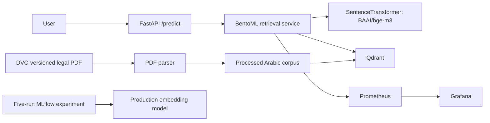

# MohamenaBot

MohamenaBot is a citation-first retrieval chatbot for the Egyptian Civil Code. It
embeds Arabic questions, retrieves matching provisions from Qdrant, and returns
the source article. It does **not** generate legal advice or fabricate an answer.

## Quick start

The repository's PDF and processed corpus are DVC data. Configure a shared DVC
remote and run `dvc pull` before building a fresh clone. The first container
startup downloads `BAAI/bge-m3` and indexes the corpus, so it needs internet
access and enough memory for the embedding model.

```powershell
python -m pip install -e ".[dev,mlops,serve]"
dvc pull
docker compose up --build -d
curl.exe -X POST http://localhost:8000/predict `
  -H "Content-Type: application/json" `
  -d '{"query":"ما هي آثار العقد؟","top_k":3}'
```

`docker compose up` starts the API, BentoML retrieval service, Qdrant, MLflow,
Prometheus, and Grafana. A successful `/predict` response includes ranked
provisions, citations, and the embedding-distance monitoring value. Repealed
articles are excluded unless `include_repealed` is set to `true`.

## API

| Method | Path | Purpose |
| --- | --- | --- |
| `GET` | `/health` | Readiness of the API and retrieval backend |
| `POST` | `/predict` | Retrieve cited legal provisions |
| `GET` | `/metrics` | Prometheus-compatible service metrics |

Example request:

```json
{
  "query": "ما هي آثار العقد؟",
  "top_k": 3,
  "include_repealed": false
}
```

`top_k` must be between 1 and 20. The response has a `results` array with each
passage's score, text, article number, and citation. FastAPI validates requests
with Pydantic; synchronous model work is dispatched off the async event loop.

## Packaging and local development

Python 3.11 or newer is required.

```powershell
python -m pip install -e ".[dev,mlops,serve]"
pytest -q
ruff check src tests
```

The installable `mohamenabot` package exposes a `mohamenabot` CLI entry point.
Runtime dependencies are in `pyproject.toml`; experiment and test dependencies
are optional extras.

## Data and experiment workflow

1. Configure a DVC remote that is accessible to the project team.
2. Track the input PDF with DVC and push it to that remote.
3. Run `dvc repro` to parse the PDF, validate the corpus, and compare five
   chunk-size configurations.

The experiment logs parameters, retrieval recall@3, chunk statistics, chunk
JSON, and evaluation diagnostics to MLflow. It registers the best embedding
model as `MohamenaBotEmbedder` and promotes its version to the `Production`
stage. MLflow is available at `http://localhost:5000`.

The current retrieval evaluation uses the first 20 words of each of up to 50
articles as a smoke-test query. This is reproducible, but is not a replacement
for a human-labeled, held-out legal-question benchmark; review the logged
metrics before claiming production retrieval quality.

## Monitoring and load testing

- Grafana: `http://localhost:3000` (local-only default login: `admin` /
  `mohamenabot-local-only`; set `GRAFANA_ADMIN_PASSWORD` before using outside
  local development).
- Prometheus: `http://localhost:9090`.
- MLflow: `http://localhost:5000`.

Prometheus scrapes prediction latency, request volume, retrieved result counts,
and `mohamenabot_embedding_input_drift`. The drift signal is the query's
normalized cosine distance from the corpus embedding centroid; the configured
alert fires above 1.5 times the corpus p95 distance for five minutes. Calibrate
this threshold against representative production traffic before enabling
operational paging.

Run the included Locust scenario and save its HTML report:

```powershell
New-Item -ItemType Directory -Force reports
locust -f locustfile.py --host http://localhost:8000 --users 5 --spawn-rate 1 --run-time 60s --headless --html reports/locust.html
```

Record the observed p95 from `reports/locust.html` here after running against
the target deployment: **p95: not yet measured**. A source-code change cannot
substitute for a measured latency report or a Grafana screenshot.

## CI and image publishing

GitHub Actions runs Ruff, pytest, and a Docker build for pull requests. The
workflow publishes trusted same-repository pull-request images to GHCR and
publishes `latest` plus the commit SHA after merges to `main` or `master`.
Fork pull requests build without registry write access. Set repository package
visibility and branch-protection rules in GitHub to match the deployment policy.

## Architecture



## Rubric evidence and remaining human actions

| Area | Implementation/evidence |
| --- | --- |
| Code and packaging | `src/mohamenabot`, typed Pydantic models, `pip install -e .` |
| API | Async `/predict` and `/health` endpoints |
| Docker | Root `Dockerfile` and `docker-compose.yml` |
| MLflow | Five runs, metrics/artifacts, registered Production model |
| DVC | PDF-to-corpus-to-experiment pipeline; a shared remote must be configured |
| GitHub Actions | Lint, tests, image build, conditional GHCR publishing |
| Production serving | BentoML retrieval service with a FastAPI API gateway; Locust script provided |
| Monitoring | Prometheus metrics, Grafana dashboard, drift and latency alert rules |
| Peer review | Must be written and submitted by the project author/reviewer |
| README and architecture | Setup, architecture diagram, runbook, and this change log |

## Session changelog

- Added a packaged, citation-first retrieval API and BentoML serving backend.
- Fixed flattened-article chunking so every chunk respects its word limit and
  retains legal metadata.
- Added five-run MLflow retrieval experiments, DVC pipeline configuration,
  Docker Compose services, CI, Prometheus/Grafana monitoring, and Locust tests.
